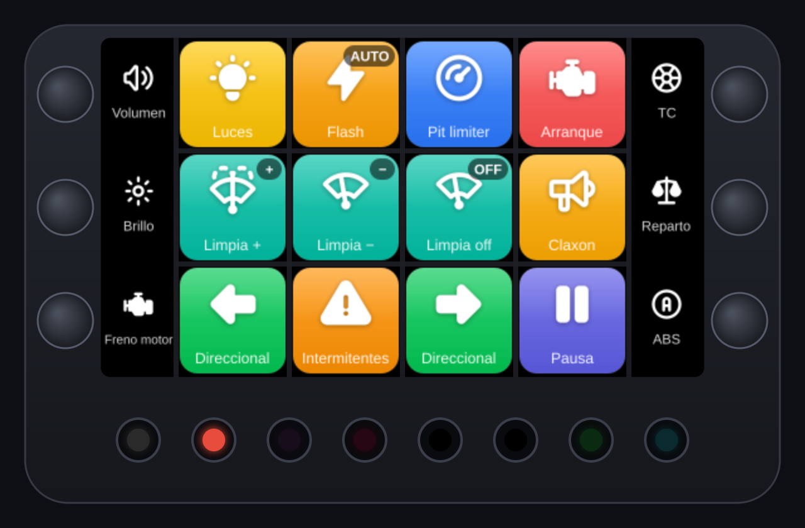
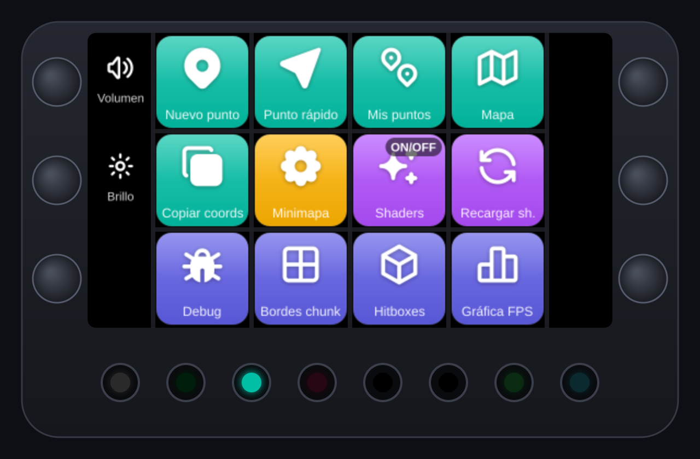
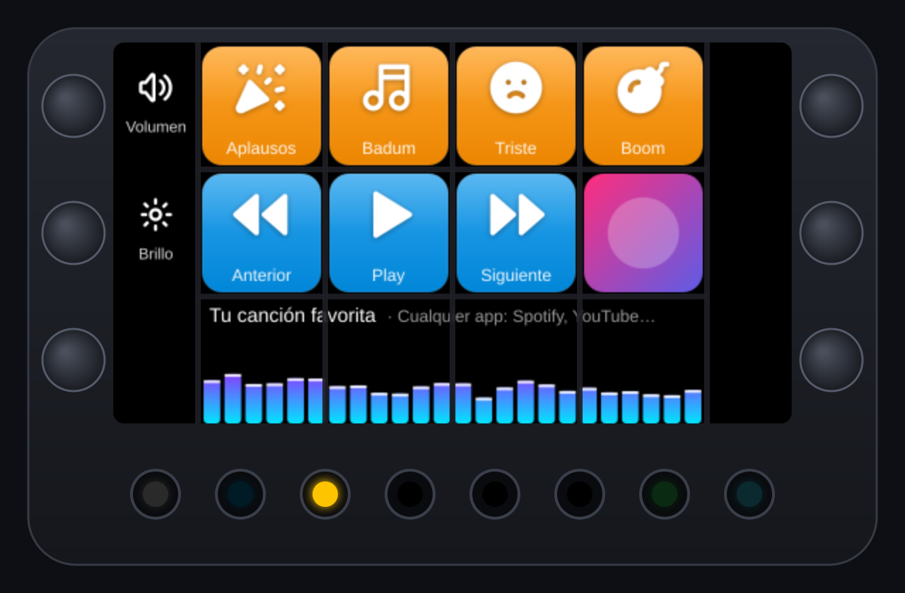
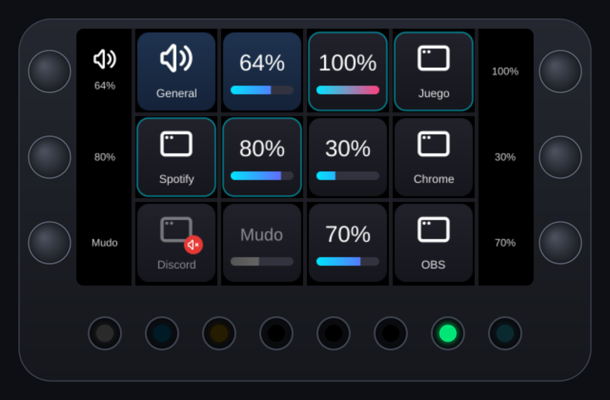
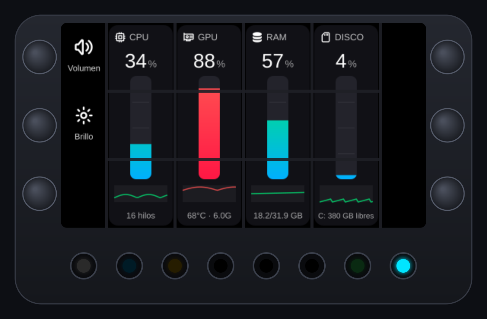
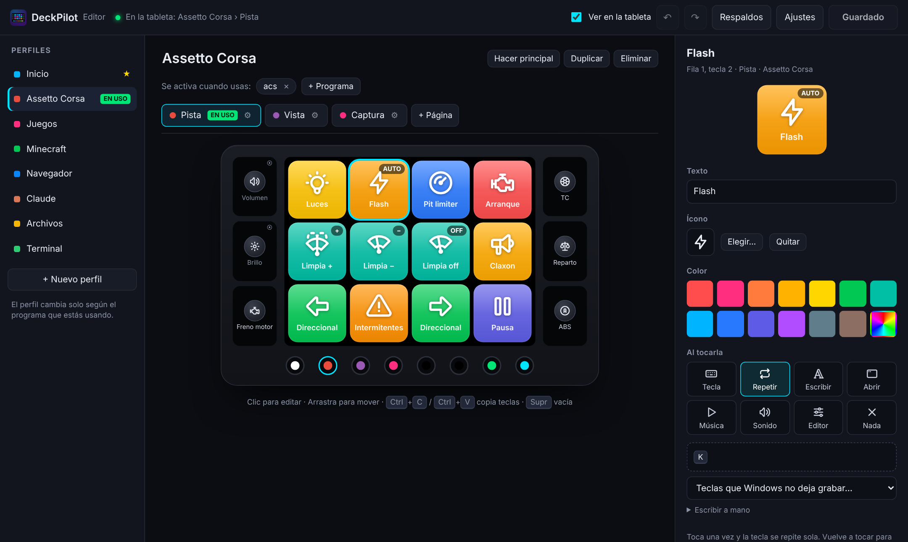

# DeckPilot

  

> Hecho sobre la librería [foxxyz/loupedeck](https://github.com/foxxyz/loupedeck), que hace posible hablar con el controlador. ¡Gracias!

Programa para Windows que reemplaza a Loupedeck en el **Razer Stream Controller** (también conocido como Loupedeck Live). Arranca rápido, cambia de perfil solo según el programa o juego que estés usando y trae un editor visual para configurar cada botón.

## Qué hace

- **Perfiles automáticos:** la tableta cambia sola según la ventana activa (juegos, navegador, terminal…).
- **Editor visual:** se abre en tu navegador y se usa con clics. Para asignar una tecla, presionas la combinación en tu teclado. Al guardar, la tableta cambia al instante.
- **Mezclador de volumen por app** (botón redondo 7): cada perilla controla una app que esté sonando.
- **Monitor de rendimiento** (botón redondo 8): CPU, GPU, RAM y disco en vivo.
- **Página de música:** portada, nombre de la canción y barras que se mueven con el audio.
- **Botón Home** de ida y vuelta: un toque te lleva a Inicio y otro te regresa a la app.
- Íconos en alta calidad (Tabler Icons) y el ícono real de cada programa.

Perfiles incluidos de ejemplo: Assetto Corsa, Minecraft, juegos (captura NVIDIA y Game Bar), navegador, Claude, Explorador de archivos y terminal.

## Capturas

| Minecraft (página Mundo) | Música |
|---|---|
|  |  |
| **Mezclador de volumen por app** | **Monitor de rendimiento** |
|  |  |

### Editor visual

## Requisitos

- Windows 10 u 11
- [Node.js](https://nodejs.org) versión LTS
- Razer Stream Controller conectado por USB

## Instalar

1. Descarga esta carpeta y déjala donde quieras, por ejemplo en `Documentos\DeckPilot`.
2. Doble clic en **`iniciar.bat`**. La primera vez instala lo necesario (tarda un minuto) y crea dos accesos directos en el escritorio: **DeckPilot** y **Editar DeckPilot**.
3. Si Loupedeck está abierto, DeckPilot lo cierra, porque los dos no pueden usar el controlador al mismo tiempo.

A partir de ahí, usa el acceso directo **DeckPilot** del escritorio.

## Personalizar

Doble clic en **Editar DeckPilot**, o mantén presionado el botón Home 1.5 segundos.

- Haz clic en una tecla o perilla y cambia su texto, ícono, color y acción.
- Para asignar una tecla: haz clic en el recuadro y presiona la combinación.
- **"+ Programa"** elige qué juegos o apps activan cada perfil.
- Arrastra teclas para moverlas. Ctrl+C / Ctrl+V copia teclas entre perfiles.
- Ctrl+S guarda. Cada guardado hace un respaldo en `respaldos\`.

Tu configuración vive en `config.json`. La primera vez se crea a partir de `config.ejemplo.json`.

## Botones redondos

| Botón | Función |
|---|---|
| 1 | Home: ir a Inicio, o regresar a la app |
| 2 a 6 | Páginas del perfil actual |
| 7 | Mezclador de volumen por app |
| 8 | Monitor de rendimiento |

## Notas

- **Assetto Corsa:** para que las luces, el flash y las cámaras funcionen junto con el volante, en `Documentos\Assetto Corsa\cfg\controls.ini` pon `COMBINE_WITH_KEYBOARD_CONTROL=1`. Haz una copia del archivo antes de cambiarlo.
- **Minecraft:** las teclas del ejemplo son para un modpack con Xaero's Minimap, Iris, Jade y Traveler's Backpack. Ajústalas en el editor a tus mods.
- **Volver a Loupedeck:** cierra DeckPilot y abre `volver_a_loupedeck.bat`. DeckPilot no modifica nada de Loupedeck.
- **Mac:** el controlador no guarda nada adentro, así que en una Mac sigue funcionando con su Loupedeck normal.
- El editor solo escucha en tu propia PC (127.0.0.1). No usa internet.

## Créditos

- [foxxyz/loupedeck](https://github.com/foxxyz/loupedeck) (MIT): comunicación con el controlador.
- [Tabler Icons](https://tabler.io/icons) (MIT): íconos.

## Versiones

- **1.0.1**: capturas en el README, licencia MIT y archivos `.bat` con fin de línea de Windows al descargar.
- **1.0.0**: primera versión pública.

## Licencia

MIT. Ver [LICENSE](LICENSE). Las librerías e íconos de terceros conservan sus propias licencias (ver Créditos).
